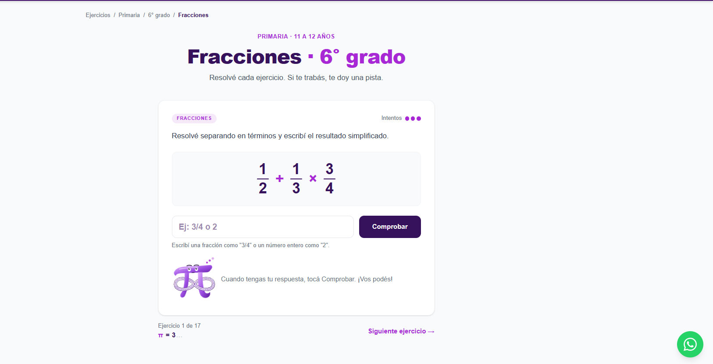
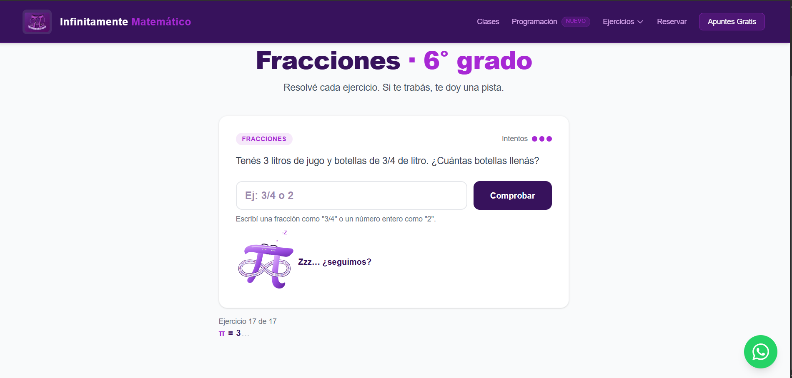

# Infinitamente Matemático

Sitio de mis clases online de matemática, física y programación, con una sección de **ejercicios interactivos** para que los alumnos practiquen solos y reciban ayuda a medida que se equivocan.

**[infinitamentematematico.com](https://infinitamentematematico.com)**



## Qué tiene

- **Landing de clases** con servicios, reseñas de Google, preguntas frecuentes y reserva de una clase de prueba con Calendly.
- **Página de programación** con el temario y una lista de espera.
- **Ejercicios interactivos de fracciones**: 99 ejercicios para primaria (4° a 6° grado) y secundaria (1° a 3° año).
- **Tabla de equivalencias** entre los cursos de Argentina y los de Uruguay, Chile, México, Colombia, Perú, España y Ecuador, para que familias de otros países encuentren su nivel.

## Cómo funcionan los ejercicios

Cada ejercicio se corrige en el momento y acompaña al alumno en vez de solo marcar el error:

- **Tres intentos con pistas progresivas.** Después del primer y del segundo error aparece una pista más concreta; al tercero se muestra la resolución paso a paso.
- **Respuestas equivalentes.** Si la respuesta es correcta pero no está simplificada (6/8 en vez de 3/4), no cuenta como error: el mensaje lo reconoce y pregunta si se puede simplificar.
- **Distintas formas de responder**: escribir una fracción o un número mixto, pintar partes de una figura, completar casilleros, comparar, ubicar en la recta numérica y plantear un problema en varios pasos.
- **Pi, la mascota**, cambia de cara según cómo le va al alumno y festeja cada tres respuestas seguidas bien.
- Al terminar, el alumno ve una invitación a seguir practicando o a reservar una clase de prueba, según cómo le fue.

<p align="center"></p>

Los ejercicios son datos, no código: cada uno es un objeto con su enunciado, la respuesta, el tipo de respuesta, dos pistas y la resolución. Para sumar ejercicios no hace falta tocar componentes, y un tipo de respuesta nuevo se agrega en un solo archivo (`src/lib/tiposRespuesta.js`).

```js
{
  id: "fracciones-primaria-suma-mismo-denominador",
  contexto: "Lucía leyó 2/7 de un libro el sábado y 3/7 el domingo. ¿Qué parte del libro leyó en total?",
  operacion: "2/7 + 3/7",
  tipoRespuesta: "fraccion",
  respuesta: "5/7",
  pistas: [
    "Las dos fracciones tienen el mismo denominador. Cuando pasa eso, el denominador no cambia.",
    "Sumá solo los numeradores y dejá el 7 abajo.",
  ],
  resolucion: [ /* pasos */ ],
}
```

## Stack

- **Next.js 16** con App Router y rutas dinámicas (`/ejercicios/[nivel]/[curso]/[tema]`) generadas en el build con `generateStaticParams`
- **React 19**
- **Tailwind CSS 4**
- **Framer Motion** para animaciones
- **Calendly** para reservar clases y **Google Analytics**
- Metadatos por página y sitemap generado a partir de los ejercicios disponibles

## Correrlo en local

```bash
npm install
npm run dev
```

Variables opcionales en `.env.local`:

```
NEXT_PUBLIC_WHATSAPP_NUMBER=549XXXXXXXXXX
NEXT_PUBLIC_GA_ID=G-XXXXXXXXXX
```

## Estructura

```
src/
  app/                  páginas: inicio, programación, recursos y ejercicios
  components/           secciones de la landing
  components/ejercicios/ ejercicio, tipos de entrada, recta numérica, figuras y Pi
  data/ejercicios/      ejercicios por nivel y curso, y equivalencias entre países
  lib/                  corrección de fracciones, figuras y recta numérica
```

---

Hecho por [Vanesa Soria](https://vsweb.dev).
